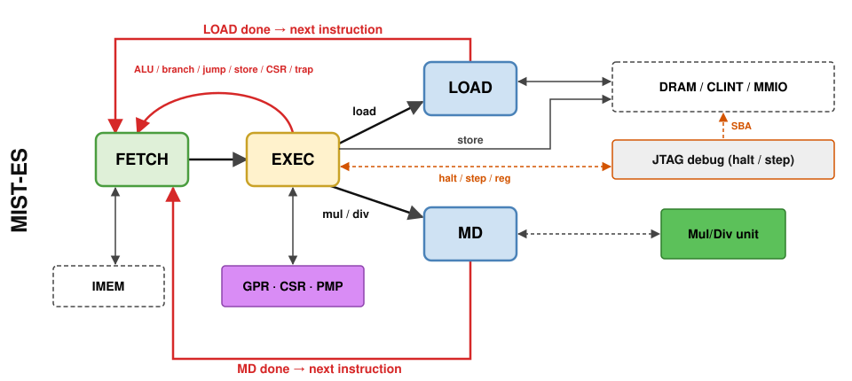

<div align="center">

# MIST-ES

<p align="center">
  
  
  
  <a href="https://www.linkedin.com/company/open-risc-v/"></a>
  <a href="https://or5.org"></a>
</p>

</div>

A compact, fully verified **RV32IMC** processor core in synthesizable SystemVerilog. Built around a deterministic multi-cycle state machine with zero pipeline or hazard overhead, it targets embedded control planes, secure boot ROMs, safety-critical subsystems, and resource-constrained FPGA soft-cores.



---

## Overview

| | |
| :--- | :--- |
| **ISA** | `RV32IMC_Zicsr` |
| **Microarchitecture** | Multi-cycle FSM, non-pipelined, deterministic |
| **Privilege Modes** | Machine (M); optional User (U) in `SECURE` configuration |
| **Security & Memory Protection** | 8-region PMP + Smepmp (`mseccfg`: MML, MMWP, RLB) |
| **Reliability** | SECDED (39, 32) ECC-protected register file (`SECURE` build) |
| **Bus Interfaces** | Native memory port + AXI4-Lite master/slave bridge |
| **Debug** | RISC-V External Debug via JTAG (debug spec 0.13, DTM + DM) |
| **Arch Compliance** | Official RISC-V Architectural Test Suite (`riscv-arch-test`) + `riscv-tests` |
| **Target FPGA** | Digilent Arty A7-100T (xc7a100tcsg324-1) |

---

## Features

- **Predictable, Zero-Hazard Execution:** Single instruction walks a short FSM (`FETCH` → `EXEC` → `{LOAD | MD}` → `FETCH`) with zero pipeline hazards and no forwarding complexity
- **Full Standard Extension Coverage:** Complete support for `I` (base integer), `M` (hardware multiply/divide), `C` (16-bit compressed instructions with transparent decompression), and `Zicsr` (CSR access)
- **Two-Tier Trust Model (`SECURE` Build):** Optional `SECURE` build adds User privilege mode and an 8-region Physical Memory Protection (PMP) unit with **Smepmp** rules: Machine Mode Lockdown (`MML`), Machine Mode Whitelist Policy (`MMWP`), and Rule Locking Bypass (`RLB`)
- **Register File ECC:** `SECURE` configuration includes a single-error-correct, double-error-detect (**SECDED 39, 32**) Hamming-code protected register file for high-reliability and radiation-tolerant environments
- **Hardware-Resolved Misalignment:** Unaligned loads and stores are handled natively in hardware as two memory beats without raising exceptions
- **RISC-V External Debug over JTAG:** JTAG Debug Transport Module (DTM) and RISC-V Debug Module (0.13 spec) supporting halt, register/CSR inspection, system-bus memory read/write, resume, and single-step
- **Dual Bus Interfaces:** Zero-latency native memory port for tightly-coupled memory integration, plus drop-in **AXI4-Lite master/slave** bridge for standard SoC fabrics
- **Clean Synthesizable RTL:** Pure SystemVerilog with no proprietary IP, tested on Digilent Arty A7-100T and verified across Icarus Verilog, Verilator, and Vivado

---

## Resource Utilization

Synthesized and implemented with **AMD Vivado 2023.2** targeting the **Digilent Arty A7-100T** (`xc7a100tcsg324-1`) evaluation board.

| Configuration | LUT | DSP | BRAM |
| :--- | :---: | :---: | :---: |
| **MIST-ES Core (Default RV32IMC)** | 2,611 | 4 | 0 |


---

## Benchmark Metrics

Measured in cycle-accurate Verilator simulation compiled with `riscv-none-elf-gcc -O2 -march=rv32imc_zicsr -mabi=ilp32` and bare-metal execution on physical FPGA silicon targeting the **Digilent Arty A7-100T** (`xc7a100tcsg324-1`).

| Benchmark | Simulation (Verilator) | FPGA (Arty A7-100T @ 50 MHz) |
| :--- | :--- | :--- |
| **CoreMark 1.0** (1,000 iterations) | **1.18 CoreMark/MHz** (847,547.1 cycles/iter, CRC Validated) | **1.18 CoreMark/MHz** (59.0 CoreMark) |
| **Dhrystone 2.1** (100,000 runs) | **0.388 DMIPS/MHz** (CPI = 2.973, 683 Dhrystones/sec/MHz) | **0.388 DMIPS/MHz** (19.40 DMIPS) |


Detailed results, compiler flags, and methodology: **[benchmark.md](benchmark.md)**

---

## Requirements

| Tool | Version | Purpose |
| :--- | :--- | :--- |
| **Icarus Verilog** | 12.0 or later | Core simulation (`iverilog` / `vvp`) |
| **Python** | 3.10 or later | Test-program builders and co-simulation |
| **RISC-V GCC** | 13.0 or later (`riscv-none-elf-*` or `riscv64-unknown-elf-*`) | Compiling SECURE (`pmp`/`epmp`/`upriv`/`mml`) and FPGA test firmware |
| **Vivado** | 2023.2 *(optional)* | FPGA synthesis and implementation for Digilent Arty A7-100T (xc7a100tcsg324-1) |

Set `RISCV_TC=/path/to/toolchain/bin` to point at a non-`PATH` toolchain.

---

## Build & Test

A single top-level **Makefile** covers the most common workflows. For fine-grained control every action is also available directly through `build.sh`.

### Makefile targets

```bash
make              # compile RTL + run self-checking smoke test
make debug        # JTAG DTM + RISC-V Debug Module verification
make pmp          # SECURE config: User mode + PMP enforcement
make mml          # SECURE config: Smepmp Machine Mode Lockdown
make clean        # remove simulation and build artifacts
make help         # list all targets
```

### All `build.sh` actions

```bash
./build.sh            # smoke test (halting at cycle 431 with tohost = 1)
./build.sh cosim      # co-simulate against the golden RV32IM ISA model
./build.sh rvfi       # RISC-V Formal Interface trace self-check
./build.sh debug      # JTAG DTM + Debug Module bit-bang verification
./build.sh pmp        # SECURE config: User mode + PMP test program
./build.sh epmp       # SECURE config: Smepmp (mseccfg) rules test
./build.sh upriv      # SECURE config: U-mode CSR / MRET privilege checks
./build.sh mml        # SECURE config: Smepmp Machine Mode Lockdown rules
./build.sh ecc        # Register-file SECDED ECC unit test
./build.sh axil       # AXI4-Lite bridge protocol validation
./build.sh fpga       # FPGA SoC simulation (UART banner + LED blink)
./build.sh clean      # remove build artifacts
./tests/run_tests.sh  # full regression battery checked against tests/expected.txt
```

Every action exits non-zero if the testbench reports `FAIL`, `TIMEOUT`, `MISMATCH`, or does not print its `PASS` verdict.
Full pass/fail results, logs, and per-test details: **[tests.md](tests.md)**.

---

## Configuration Options

MIST-ES ships in two build-time configurations, selected by the `SECURE` RTL parameter or compile-time define `-DMIST_ES_SECURE`:

| Property / Feature | Default | SECURE |
| :--- | :--- | :--- |
| **Privilege Modes** | Machine (M) only | Machine (M) + User (U) |
| **Memory Protection** | — | 8-region PMP + Smepmp (`mseccfg`: MML, MMWP, RLB) |
| **Register File** | Plain 32×32-bit GPR | SECDED (39, 32) ECC protected |
| **Target Use Case** | Smallest area footprint | Isolation, security, high reliability |
| **`misa` U-bit** | Not set | Set (bit 20 = 1) |
| **Locked PMP Regions** | — | Enforced on Machine mode as well |

---

## Repository Layout

```
MIST-ES/
├── Makefile                    top-level build & test entry point
├── build.sh                    fine-grained simulation & test driver
├── tests.md                    comprehensive verification & test report
├── benchmark.md                detailed performance benchmarks (CoreMark, Dhrystone)
├── rtl/
│   ├── mist_es_core.sv         multi-cycle datapath & control FSM
│   ├── mist_es_soc.sv          minimal SoC wrapper (IMEM, DRAM, CLINT, tohost)
│   ├── mist_es_debug.sv        JTAG DTM + RISC-V Debug Module (0.13 spec)
│   ├── mist_es_axil.sv         AXI4-Lite master/slave adapter & SoC wrapper
│   └── common/                 shared leaf cells (ALU, MulDiv, RegFile, RegFile ECC,
│                               CSR, RVC, ImmGen, Branch, Decode, PMP)
├── tb/                         testbenches (tb_mist_es.sv, RVFI, debug, ECC, AXI)
├── tests/                      regression test runner and baseline
│   ├── run_tests.sh            automated regression runner (checks against tests/expected.txt)
│   └── expected.txt            golden regression test verdicts baseline
├── fpga/                       FPGA top-level SoC wrapper + Digilent Arty A7-100T XDC constraints
├── programs/                   assembly smoke test builders
├── sw/                         firmware, binary-to-hex utilities, bring-up tests
└── tools/                      golden Python ISA model + co-simulation driver
```

---

## License

Released under the [MIT License](LICENSE) — free for commercial, research, and academic use.
